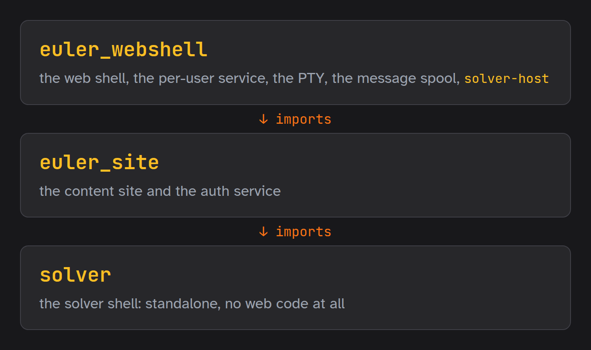

# Package Guide — three packages, one shell

This guide covers how the code is **packaged**: the three packages and which way they may
depend on each other, how the web shell extends the solver shell without the solver shell
knowing, who a session runs as, where the public and the signed-in content come from, and
how the packages are versioned and deployed together. The packages live under
[`packages/`](../packages/), the content wheel among them ([`packages/content/`](../packages/content/)).

The short version, for when that is all you need:

| I want to… | do this |
| --- | --- |
| add a command | put it in [`packages/solver/solver`](../packages/solver/solver/) — unless it needs the spool, the roster or the mail relay (§3.4) |
| run the shell | `solver` — or, on the web host, `solver-host` for the host's own commands (§3.4) |
| change what the web shell does to a command | edit [`overlays.toml`](../packages/webshell/euler_webshell/shell/overlays.toml) (§3.2) |
| tell staff about something a command found | `solver.core.notices.to_staff(subject, body)` (§3.3) |
| regenerate the docs | `python -m euler_webshell.shell.host "update-docs"` (§3.4) |
| install for development | `make install-all` — all three packages, editable (§5) |
| deploy a change to the layout or a unit | `make upgrade-web`, not `redeploy-web` (§5.3) |

---

## 1. The shape



```
packages/
  solver/    euler-solver    import solver           the solver shell: standalone, no web code
  site/      euler-site      import euler_site       the content site and the auth service
  webshell/  euler-webshell  import euler_webshell   the web shell, the per-user service, the spool
  content/   euler-content   import euler_content    the published content, as data
```

| Package | What it holds |
| --- | --- |
| **euler-solver** | the shell (`shell`), the domain (`core`: problems, git, progress), keys and the vault (`crypto`), the AI commands (`ai`), the runners, templates, config, and the identity kernel (`auth`) |
| **euler-site** | the content app (`euler_site.site`), the auth service (`euler_site.auth`), the shared service helpers (`cache`, `csp`, `store`, `unixhttp`, `envfile`), the auth pages' templates, and the static tree Caddy serves (`content/`) |
| **euler-webshell** | the PTY service (`ws`), the per-user service (`user`), the message spool (`msg`), the web shell itself (`shell`: OSC, overlays, ticket identity, key distribution, `solver-host`), the collaborator roster (`roster`) and the `users` command (`users`) |
| **euler-content** | `README.md`, `docs/`, `topics/`, `solutions/public/`, `solutions/problems.json` and the few package files the pages link to — never `solutions/private` (§4) |

Dependencies point **one way**:

```
euler_webshell  →  euler_site  →  solver
```

The site uses the solver's *domain* — problems, the progress parser, paths, the identity
kernel — never its shell; nothing in the site imports the web shell. That direction is what
lets the solver shell be installed and run on its own, with no web code in it at all, and
it is enforced rather than hoped for: [`scripts/linters/layers.py`](../scripts/linters/layers.py)
reads every module of the two lower packages and fails on an import that points up — top-level
or lazy, `import x` or `from x import y` — and on a command module in the solver's loader
manifest that is not the solver's own. It runs in the pre-commit hook and in `check.sh`.
Known exceptions would go in [`layers.allow`](../scripts/linters/layers.allow), which only
ratchets down; it is empty.

---

## 2. Who a session is

[`packages/solver/solver/shell/login.py`](../packages/solver/solver/shell/login.py) settles
two things at startup, run by `solver.main.main`:

1. `identify()` — the subject, **before any command module loads**, because each command's
   floor is checked against it as it registers;
2. `unlock()` — the vault, after the commands and the extension have loaded, so a broken
   extension refuses the session before anyone is asked for a password.

### 2.1 Who: the OS login, or the extension's

The solver shell's identity is the **OS login** of the process's real uid — read from the
password database, never from `$USER` or `$LOGNAME`, which the user sets
([`auth/identity.py`](../packages/solver/solver/auth/identity.py)). An extension may bring its
own (§3.1): the web shell redeems the one-time **shell ticket** its PTY was forked with
([`shell/identity.py`](../packages/webshell/euler_webshell/shell/identity.py)), refuses to start
without one, and scrubs it from the environment so no child inherits it.

A `solver` that a web shell starts — `claude-solve`'s headless Claude, a `! solver "…"` — is a
plain solver shell: it has no ticket and resolves from its uid, which is the collaborator's
per-user account. §2.2 is what gives it that collaborator's identity and rung.

### 2.2 Role: a guardrail, not a boundary

The role comes from a policy the user cannot rewrite — `/etc/euler/authorizations.json`,
root-owned, keyed by e-mail or OS login:

| Policy deployed? | Login | Role |
| --- | --- | --- |
| yes | listed | its entry |
| yes | the `system_slug` of a listed e-mail (a per-user web account) | that e-mail's entry, with the e-mail as the identity |
| yes | anything else | `reader` |
| no (a collaborator's own machine) | owns the checkout | `admin` |
| no | anything else | `contributor` |

A policy counts only if the file **and every directory above it** are root-owned and not
group- or world-writable. That rules out the two shortcuts that look tamper-proof and are not:

- *a root-owned file in `~/.euler/`* — unlink and rename are governed by the **directory's**
  permissions, so the owner of `~/.euler` can move the file aside and put their own in its
  place;
- *an HMAC of the role in an environment variable* — verifying an HMAC needs the secret in the
  verifying process, and whoever holds the secret can mint one (a token would need a
  *signature* instead).

The same rule applies to an `EULER_AUTHZ_FILE` override: one the user can write is ignored.

Even so, the role is a **guardrail**. Inside one uid — where the user can edit their clone, run
`!`, or call Python directly — no in-process check can stop them. The role prevents accidents
and shapes the command set; the boundaries are elsewhere: uids and file permissions,
separate-uid services checking `SO_PEERCRED`, the master key, and GitHub's protection of
`master`. Every `maintainer` and `admin` command was audited for where its effect actually
lands and what stops a lesser profile there:
[`authorizations.md` § Where it is enforced](authorizations.md#where-it-is-enforced).
None depends on its floor alone.

### 2.3 The vault: a capability, not a proof of identity

`unlock()` tries `EULER_VAULT_KEY_FILE`, then `EULER_VAULT_PASSWORD`, then a terminal prompt —
unless the extension says `prompt_vault=False` (the web shell: the browser unlocks the vault,
and a shell that stopped to ask would stall every attach). Unlocking proves possession of the
vault password; the uid has already said who this is. What it *grants* is the master key and
the API key, and commands that need them check the key file where they need it.

---

## 3. Extending the shell

The solver shell never discovers code. A package that builds on it hands
`solver.main.main(extension=…)` an `Extension`
([`shell/extension.py`](../packages/solver/solver/shell/extension.py)). Composition is explicit on
purpose: plugin discovery (`entry_points`) would load web commands into *every* shell of a venv
the web package is installed in — a developer's terminal included.

### 3.1 The extension

| Field | What it adds | The web shell's |
| --- | --- | --- |
| `modules` | command modules imported after the shell's own | `HOST_COMMANDS`: `users`, `msg`, key distribution |
| `overlays` + `notify` | events after a command, or a replacement body (§3.2) | `overlays.toml`, and `osc.nudge` |
| `identity` | who the session is, instead of the OS login (§2.1) | the shell ticket |
| `prompt_vault` | whether a locked vault may be unlocked by prompting (§2.3) | no |
| `on_start` | a step before the first prompt | a quiet `git-sync`, with one line if it failed |
| `notices` | the carrier for staff notices (§3.3) | the message spool |

### 3.2 Overlays

An overlay table is TOML, one table per command:

```toml
[git-commit]
emit = ["git"]                                   # notify("git") after the command returns

[show]
replace = "euler_webshell.shell.viewer:show"     # run this body instead; same signature
```

- **`emit`** fires after the command **whatever its exit code**: every event is an idempotent
  "re-read" nudge, and a failed command may still have changed state. It is coarser than an
  emit placed inside a command — a long command moves the chip at its end — and that is the
  price of a solver shell that knows nothing of the page.
- **`replace`** runs another function behind the original's contract: the same parsing,
  coercion, help and usage. Its signature must match the original's exactly (`Ask` metadata
  aside).
- An overlay that names no command or only an alias, a replacement that does not fit, or an
  `emit` with no `notify`, **stops the shell from starting**. Every overlay is checked before
  any is applied, so a half-applied table never runs. An overlay on a command the subject is
  below the floor of is skipped, not refused.

The web shell's table makes the state-changing commands refresh the header's chips and the
solutions grid, and replaces `show` / `edit` with bodies that swap the page's left pane
([`viewer.py`](../packages/webshell/euler_webshell/shell/viewer.py)); `key-rekey` gains the
re-issue to every registered holder. The generated table *What the web shell changes* in the
[command catalogue](commands-catalogue.md) lists it all, and `tests/test_web_shell.py` checks
the real tables against the full registry.

### 3.3 Notices

Some commands finish by handing work to somebody else: `git-push` opens a pull request a
maintainer lands, `summary` finds answers nobody registered, `user` mints a key that needs
issuing, a merge dismisses the review notice. The text depends on what the command found half
way through, which an overlay cannot express, so the solver names the notice and an extension
delivers it ([`core/notices.py`](../packages/solver/solver/core/notices.py)):

```python
from solver.core import notices
from solver.core.notices import PR_REVIEW_SUBJECT

if not notices.to_staff(f'{PR_REVIEW_SUBJECT}{branch}', body):
    console.print('…tell a maintainer yourself…')
```

With no carrier installed nothing is sent and the call returns `False`, so the command says
what to do by hand. The subjects live in the same module because they are a contract between
the commands that file them and the spool that reads them (its chip offers `merge` on a review
row and `save` on a key row). `notices.key_hint()` is the carrier's wording for where a waiting
master key is taken: the header's message chip over the web, `msg act` on the host,
`host-unlock` anywhere else.

### 3.4 Which shell has which command

| Shell | Run as | Commands |
| --- | --- | --- |
| `solver` | `solver`, `python -m solver` | the solver package's |
| the web shell | `python -m euler_webshell.shell` — what the browser's terminal runs | those, overlaid (§3.2), plus the web host's |
| `solver-host` | `solver-host`, `python -m euler_webshell.shell.host` — the operator's terminal on the web host | the solver's plus the web host's; the OS login, a terminal vault prompt, no OSC |

The web host's commands — `msg`, `users`, `user-authorize`, `key-split`, `host-authorize` — live
in euler-webshell because they need what only the host has: the message spool, the roster, the
mail relay. The [command catalogue](commands-catalogue.md) is split the same way.

Because the generated docs cover both sets, **`update-docs` and `check-commands` run from
`solver-host`**; a plain `solver` refuses `update-docs` where the web shell is installed rather
than silently dropping its commands from the docs.

---

## 4. Two content roots: the public site and your clone

One app ([`euler_site/site/app.py`](../packages/site/euler_site/site/app.py)) serves the content
from one of two roots:

| Visitor | Served by | Root | Surface |
| --- | --- | --- | --- |
| not signed in | `euler-site` (`EULER_SITE_PUBLIC=1`) — `build_public_app` | the installed `euler-content` tree | read routes only; no identity, no git, no terminal, no account, no writes |
| signed in | their own `euler-user@<slug>` instance | their `~/euler` clone | everything, by profile |

The docs, topics and public solutions are published unencrypted on GitHub anyway, so asking for
a login to read them protected nothing. What the public site cannot show is structural, not a
check: the content wheel holds no `solutions/private`, and its unit runs on a uid of its own with
`ProtectHome=true` and AF_UNIX only, so no clone is visible to it. Caddy picks the root by the
session cookie — a GET of a content path with no `solver_session` / `solver_remember` cookie
goes to the public site — which is not a trust decision, since either copy is public content to
whoever asks. The [web server guide](web-server-guide.md) § 11.0 has the routing and the
templates' `browsable` / `subject` split.

### 4.1 The content wheel

[`scripts/content/stage.py`](../scripts/content/stage.py) builds the wheel's source in a scratch
directory: a copy of [`packages/content/`](../packages/content/), the public tree laid into `euler_content/tree/`
in the repository's own layout, and `_version.py` stamped from the solver's version. It copies
**tracked** files under fixed public roots only — an untracked scratch file never ships — and
refuses outright if anything under `solutions/private` would be included. `euler_content.root()`
returns the installed tree, and the content readers take it exactly as they take a clone.

The public copy is as current as the last deploy: every venv deploy re-stages and reinstalls
it, so `make redeploy-web` refreshes it with the code. That is also what lets its pages be
cached: each carries an `ETag` from a fingerprint of the installed tree and the site package,
revalidated on every use and answered with a 304 without rendering (web server guide § 11.10).

---

## 5. Building, versioning, deploying

### 5.1 Installing

Each package has its own `pyproject.toml`; the root one is no package — it records the system
setup the packages need. Install the three **together**, so the pins between them resolve
against each other rather than an index:

```bash
pip install -e "packages/solver[ai,dev,show,solutions]" -e packages/site -e packages/webshell
```

That is what `make install-all` runs (`make install-minimal`: fewer solver extras). A machine
that only solves problems needs only the first. `/opt/euler`, the services' venv, gets the
same three, non-editable, plus `euler-content` (`scripts/setup/venv.sh`).

The git filter runs `python -P -m solver.crypto.gitfilter` from the dev venv, so an editable
install pointing at a path that has moved breaks every git command that touches
`solutions/private` until the venv is reinstalled.

### 5.2 One version

The packages version in **lockstep**: one number, one tag. `scripts/version/release.sh`
(`make release`) is the only writer — it derives the bump from Conventional Commits, rewrites
every package's `version.py` and the `euler-solver==X.Y.Z` / `euler-site==X.Y.Z` pins in the
site's and web shell's `pyproject.toml`, commits, tags and pushes. The content wheel takes the
solver's number at staging time. Never hand-edit a number.


### 5.3 Redeploy versus upgrade

| Change | Run |
| --- | --- |
| code, templates, CSS/JS, content | `make release`, then `make redeploy-web` |
| a module a unit starts, a unit file, a package's place | `make release`, then `make upgrade-web` |

`redeploy-web` reinstalls the venv and restarts the services against it, but re-lays no unit:
a unit that names a module the new code no longer has would fail to start. `upgrade-web`
re-lays every unit and stops every running per-user instance, whose socket restarts it on the
next request — an instance left running keeps the code it started with, and once pip has
replaced that code on disk every page it renders fails.

---

## 6. Keys across the split

The solver shell **holds and receives** keys: `user` (your key pair), `vault`, `key-reconstruct`
(complete a key from two halves), `host-unlock` (install a sealed block), a local `key-rekey`,
and `key-export`, which prints the master key sealed to a public key, to carry by any channel
you trust. That is all a standalone machine needs.

**Sending** keys needs what only the web host has, so it is the web shell's
([`shell/keys.py`](../packages/webshell/euler_webshell/shell/keys.py)): `user-authorize` and
`key-split` (half the master key over the spool, recorded in the roster), `host-authorize` (the
whole key, sealed, by mail through the relay), and `key-rekey`'s re-issue to every registered
holder, as an overlay replacement. The [gitfilter guide](gitfilter-guide.md) § 6 walks through
granting and rotating.

---

## 7. Tests

| Test | Holds |
| --- | --- |
| `tests/test_layers.py` | the layering checker, and the repository clean against its allowlist |
| `tests/test_extension.py` | overlays: emit, replace, the signature check, the refusals, atomic application; notices install |
| `tests/test_web_shell.py` | the web shell's and the host's real overlay tables against the registry; the ticket identity; the start-up sync; OSC |
| `tests/test_auth_kernel.py` | the OS-login identity and the role chain, including a policy the user can write |
| `tests/test_public_site.py` | the staged content holds nothing private; the public app's read-only surface; identity headers ignored |
| `tests/test_enforcement_audit.py` | every `maintainer` / `admin` command has a row in the enforcement audit, at its floor |

---

## 8. How it got here

The three packages were one `solver` package with the web tier under `solver/web/`. They were
separated in seven steps (October 2026), each shipped and deployed on its own:

| Step | What moved |
| --- | --- |
| 1 | the layering checker and the extension mechanism |
| 2 | OSC: the solver's commands stopped writing escape codes; the web shell overlays them |
| 3 | `login`; the ticket identity left the solver; the role from the root-owned policy |
| 4 | key distribution and staff notices to the web side; the allowlist empty; `solver-host` |
| 5 | the public site and the content wheel |
| 6 | the physical move into `packages/`, three pyprojects, lockstep releases (v4.0.0) |
| 7 | the enforcement audit; the catalogue split by shell |

The old module paths mapped one for one: `solver.web.X` became `euler_site.X` (site, auth, the
shared helpers) or `euler_webshell.X` (ws, user, msg, shell); `solver.auth.roster` became
`euler_webshell.roster`, and `solver.web.auth.commands` became `euler_webshell.users`.

---

## 9. Files

| File | Role |
| --- | --- |
| [`packages/*/pyproject.toml`](../packages/) | one per package: dependencies, pins, package data |
| [`shell/extension.py`](../packages/solver/solver/shell/extension.py) | `Extension`, overlays, `load_extension` |
| [`shell/login.py`](../packages/solver/solver/shell/login.py) | `identify()` and `unlock()` |
| [`auth/identity.py`](../packages/solver/solver/auth/identity.py) | the OS login and the role chain |
| [`core/notices.py`](../packages/solver/solver/core/notices.py) | the notices hook and the notice subjects |
| [`euler_webshell/shell/`](../packages/webshell/euler_webshell/shell/) | the web shell: extensions, overlays, identity, keys, notices carrier, OSC |
| [`scripts/content/stage.py`](../scripts/content/stage.py) | stages the content wheel |
| [`scripts/linters/layers.py`](../scripts/linters/layers.py) | the layering guard |
| [`scripts/version/release.sh`](../scripts/version/release.sh) | the lockstep release |
