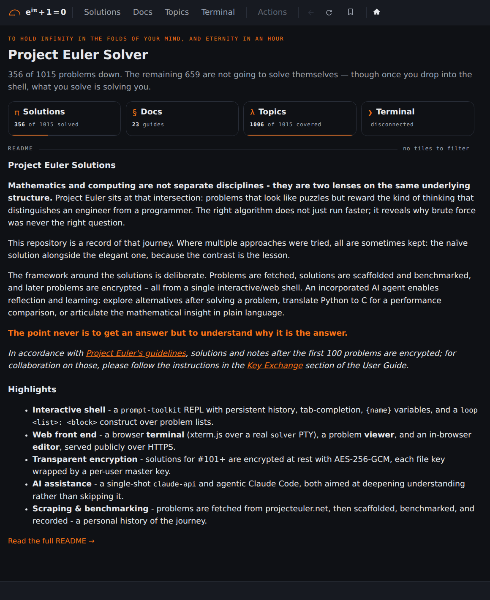

## Screenshots: Home

<b>1 / 6 · Home</b> (<a href="https://euler.vikasmunshi.com/"><code>/</code></a>), signed out. Click the left half for the previous page, the right half for the next.

[Back to the README](../../README.md)
