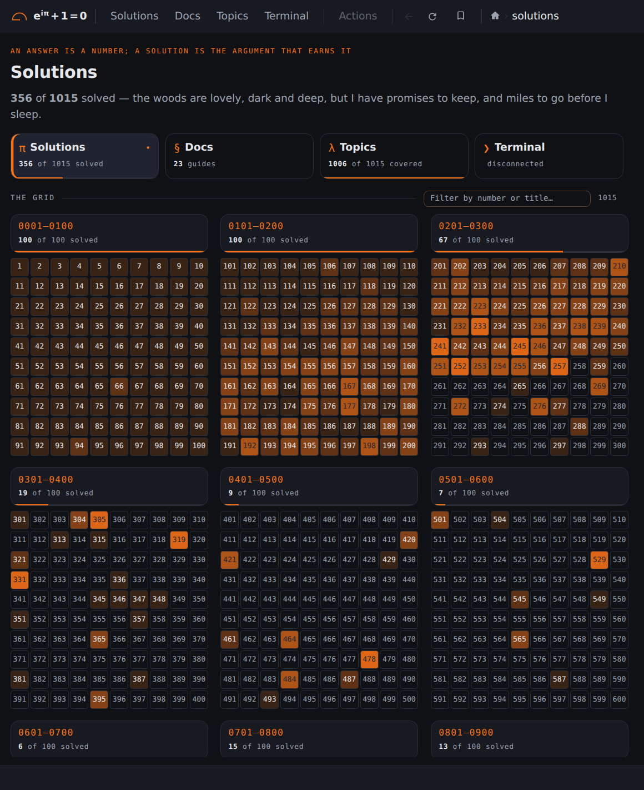

## Screenshots: Solutions

<b>2 / 6 · Solutions</b> (<a href="https://euler.vikasmunshi.com/solutions/"><code>/solutions/</code></a>), signed out. Click the left half for the previous page, the right half for the next.

[Back to the README](../../README.md)
