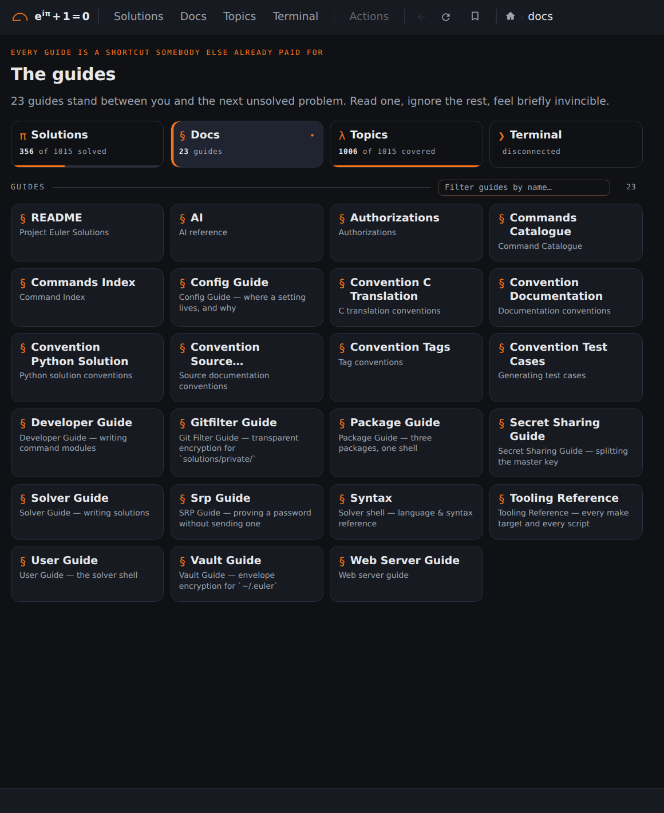

## Screenshots: Docs

<b>3 / 6 · Docs</b> (<a href="https://euler.vikasmunshi.com/docs/"><code>/docs/</code></a>), signed out. Click the left half for the previous page, the right half for the next.

[Back to the README](../../README.md)
