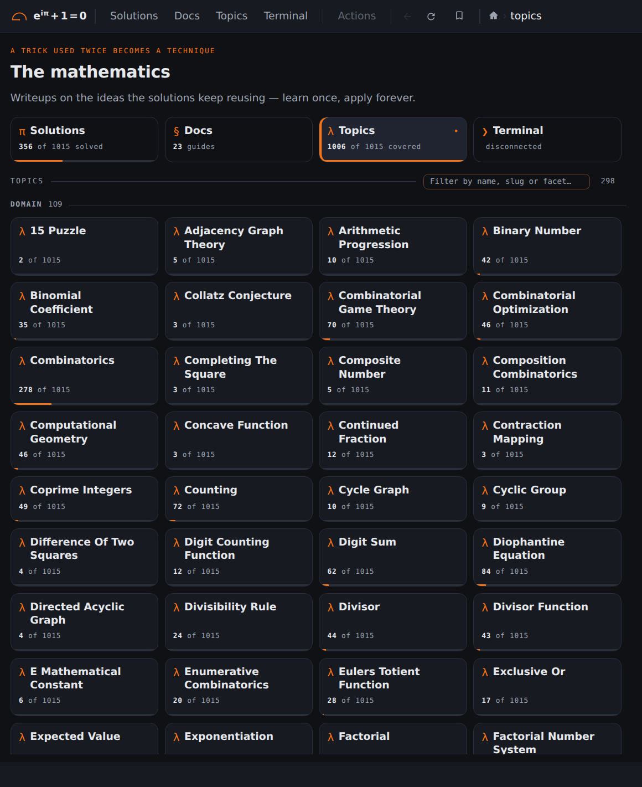
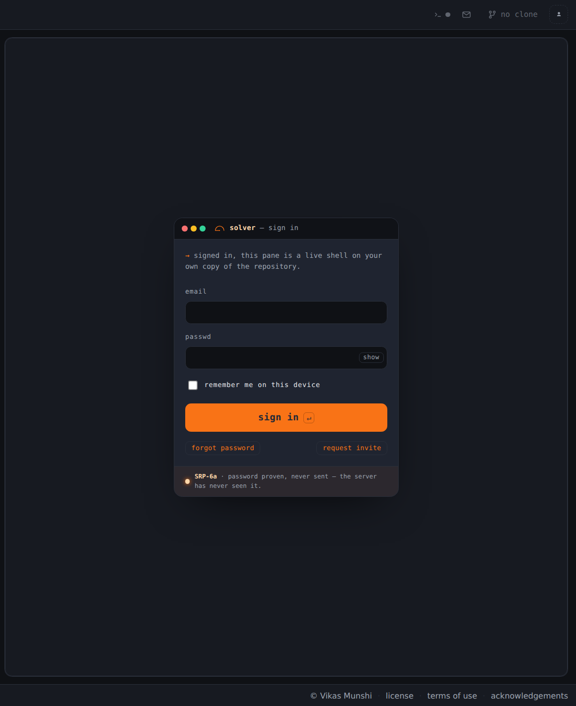

## Screenshots: Topics

<b>4 / 6 · Topics</b> (<a href="https://euler.vikasmunshi.com/topics/"><code>/topics/</code></a>), signed out. Click the left half for the previous page, the right half for the next.

[Back to the README](../../README.md)
