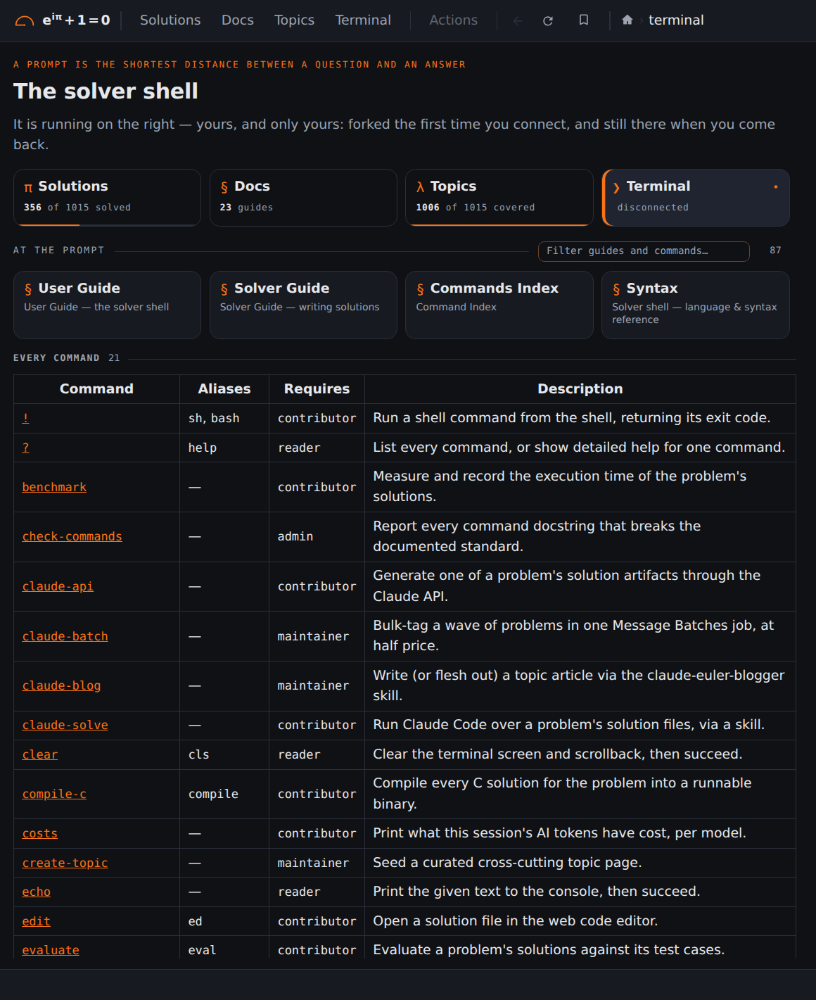

## Screenshots: Terminal

<b>5 / 6 · Terminal</b> (<a href="https://euler.vikasmunshi.com/shell"><code>/shell</code></a>), signed out. Click the left half for the previous page, the right half for the next.

[Back to the README](../../README.md)
