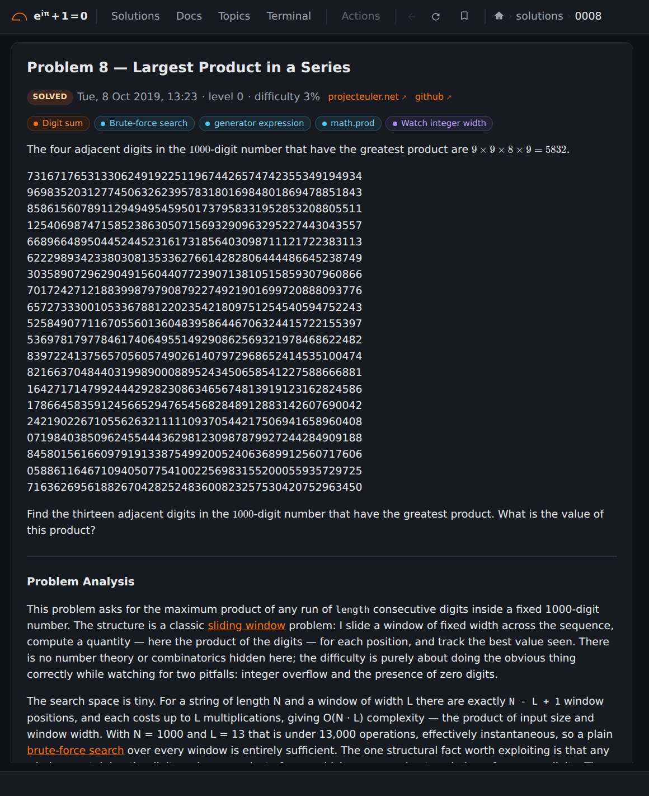

## Screenshots: Problem 8

<b>6 / 6 · Problem 8</b> (<a href="https://euler.vikasmunshi.com/solutions/8/"><code>/solutions/8/</code></a>), signed out. Click the left half for the previous page, the right half for the next.

[Back to the README](../../README.md)
