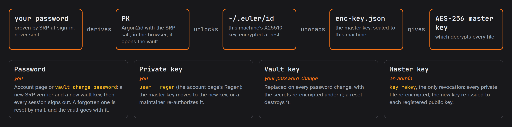

# Vault Guide — envelope encryption for `~/.euler`

This guide covers the **per-user vault**: the envelope-encryption scheme that keeps a
collaborator's X25519 private key and project env encrypted at rest, how the key reaches the
processes that need it, and how the terminal and the browser each unlock it. It is implemented
in [`packages/solver/solver/crypto/vault.py`](../packages/solver/solver/crypto/vault.py), with every interactive part in
[`packages/solver/solver/crypto/keys.py`](../packages/solver/solver/crypto/keys.py).

Related: [SRP Guide](srp-guide.md) — where the salt and the browser-derived key come from;
[Git Filter Guide](gitfilter-guide.md) — what the private key ultimately opens;
[Secret Sharing Guide](secret-sharing-guide.md) — how that private key comes to hold the
master key in the first place.

---

## 1. What it is, and what it is not

Two files in the machine-local secrets directory are worth protecting:

| file | what it is |
| --- | --- |
| `~/.euler/id` | the X25519 private key — it unwraps the master key, and through it every private solution |
| `~/.euler/env` | the project env, including `ANTHROPIC_API_KEY` |

Before the vault, both rested in plaintext with `0600` permissions inside a `0700` directory.
That is real protection against other *users* of the machine and none at all against the
machine's operator, a backup, or a stray copy of a home directory. On the deployed web host
every collaborator's secrets sit in a home directory root can read — which is precisely the
case the vault addresses.

With a vault, both files rest as ciphertext under a key that only the collaborator's password
derives.

**The boundary, stated honestly:** this is at-rest opacity against a passive or honest
operator. An active root can read a live session's memory or modify the shared solver code; no
design protects a secret from the entity that controls the CPU. The module docstring says the
same thing in the same words — this is not "zero-knowledge", and should never be described so.

---

## 2. Envelope encryption, and why

Two keys, not one:

```
password ──Argon2id("euler-vault-pk:" ‖ salt)──▶ PK ──AES-256-GCM──▶ wrapped VK   (~/.euler/vault)
                                                                        │
                                                                        ▼ unwrap
                                                                       VK ──AES-256-GCM──▶ id, env
```

- **`VK`** — the vault key: 32 random bytes that encrypt the secrets themselves.
- **`PK`** — the password key: 32 bytes derived from the password, used only to wrap `VK`.

Where the vault sits in the whole chain, from sign-in to a decrypted solution (`VK` is the step
inside "unlocks"):



Encrypting the secrets directly under `PK` would be simpler and worse: the envelope is what
lets the browser hold `PK` without ever holding the key to the file contents.

**A password change re-keys the vault** (`rekey_vault`, `rekey_vault_with_pk`): a fresh `VK`,
every vault-encrypted file (`id`, its rolling backups, `env`) re-encrypted under it, and the new
`VK` wrapped under the new `PK`. Merely re-wrapping the old `VK` would leave a `VK` that leaked
before the change — out of a session key file, say — opening everything after it. The set of
files is small, and the change is crash-safe by one commit point: each file is first staged
beside its original as `<name>.rekey`, the vault file is replaced atomically, and only then are
the staged files renamed into place. A crash before the commit leaves the old vault intact; a
crash after it leaves staged files the new `VK` opens, which the next unlock moves into place
(`_settle_rekey`), dropping any it cannot open.

The change then ends every session that still holds the old `VK`. The auth service already
ends every *other* web session on a password change and closes the live web shell; the page that
made the change signs itself out too, and the next sign-in opens the re-keyed vault. In a
terminal, `vault change-password` writes the new `VK` into the shell's key file in place
(`replace_session_key`), so that shell keeps working; any other open shell must be restarted.

### The KDF: Argon2id

```
PK = Argon2id(password, "euler-vault-pk:" ‖ salt, m = 64 MiB, t = 3, p = 1, len = 32)
```

The parameters are one string, `argon2id$m=65536,t=3,p=1` (`wire.VAULT_KDF`, mirrored in
`vault.js`), and the vault records it in its own file, so the cost can rise later without
stranding anybody. The browser derives the same `PK` with the vendored hash-wasm it already loads
for the SRP key (base.html); the terminal uses `argon2-cffi`. Every guess at a stolen
`~/.euler/vault` — readable only by its owner's uid and root — costs 64 MiB of Argon2id, the same
as a guess at a stolen `users.json`.

Vaults were PBKDF2-SHA256 (600 000 rounds) until v4.15: WebCrypto-native, so there was no
implementation to ship into the page — until the SRP key needed one anyway. Every vault was
re-wrapped under Argon2id at its next unlock (same `VK`, same salt), and the PBKDF2 path is gone.

The salt is 16 bytes — and on the web path it is *the account's SRP salt*, which the browser
already has from the login challenge ([SRP Guide §8](srp-guide.md#8-what-srp-does-not-do-here)).
The salt is public by construction in both systems; sharing it couples nothing but the input to
two independent derivations — both Argon2id at the same cost, but each labels its salt
(`"euler-vault-pk:"` here, `"euler-srp-x:"` for SRP), so they never compute the same function of
the password.

### The ciphers

Both layers are **AES-256-GCM** with a random 96-bit nonce — authenticated encryption, so a
wrong key or a corrupted blob raises `InvalidTag` rather than returning plausible garbage. That
is what makes "wrong password" a clean failure everywhere in this module.

| blob | layout | function |
| --- | --- | --- |
| wrapped `VK` | `hex( nonce ‖ AES-GCM(PK, VK) )` | `wrap_vault_key` / `unwrap_vault_key` |
| a secret file | `MAGIC ‖ nonce ‖ AES-GCM(VK, plaintext)` | `encrypt_secret` / `decrypt_secret` |

`MAGIC` is `b'VLT\x01'` (`config['vault_magic']`) — a 3-byte tag and a format version. It is
what lets `is_vault_encrypted` tell ciphertext from plaintext, which in turn makes
`encrypt_secret` idempotent and `decrypt_secret` a pass-through for files that were never
encrypted. Every migration path in the module leans on that: a vault can be initialised over a
mix of plain and already-encrypted files with no special cases.

Random nonces are safe here because the blob count per key is tiny — two files, rewritten by
hand. This is the opposite choice from the git filter, which *must* be deterministic: it derives
its nonce from the plaintext by HMAC so identical content yields identical ciphertext and git
sees no churn ([Git Filter Guide §2](gitfilter-guide.md#2-how-it-works)). Two schemes, two
requirements; neither one's rule may be carried to the other.

---

## 3. The files

| path | mode | contents |
| --- | --- | --- |
| `~/.euler/` | `0700` | the secrets dir — a sibling dot-directory named for the repo, outside the checkout |
| `~/.euler/vault` | `0600` | `{kdf, iterations, salt, wrapped_vk}` (`VaultData`) |
| `~/.euler/id` | `0600` | X25519 private key, PKCS8 PEM — vault-encrypted when a vault exists |
| `~/.euler/id.1` … `.5` | `0600` | rolling backups (`config['private_key_backups']`), each in whatever form it was written |
| `~/.euler/env` | `0600` | `KEY=VALUE` project env — vault-encrypted when a vault exists |

`~/.euler/vault` holds no secret: without the password it is `{salt, wrapped_vk}` and a round
count. It is still `0600`, because there is no reason to hand an attacker the salt.

Nothing here is ever in the checkout, and nothing here is ever committed. (The one piece of key
material that *is* committed — half the master key — is not a secret at all; see the
[Secret Sharing Guide](secret-sharing-guide.md).)

---

## 4. Getting `VK` to the processes that need it

The code that needs `VK` does not run in the shell. `load_private_key` runs inside the **git
clean/smudge filter**: a short-lived subprocess git spawns with its own environment and a stdout
that carries file content. So the key has to survive process boundaries without being prompted
for again and without being printed.

```
interactive shell ── unlock_session() ──▶ VK ──▶ write_session_key()
                                                     │
                          $XDG_RUNTIME_DIR/euler/vk-XXXX   (tmpfs, 0600, uid-private)
                                                     │
                      os.environ['EULER_VAULT_KEY_FILE'] = <that path>
                                                     │
                       inherited by every child: git filter, solver subprocesses
```

The **path** is in the environment; the **key** is in a uid-private file on tmpfs. That split is
deliberate: a process's environment is readable from `/proc/<pid>/environ` by anyone who can
read the process, whereas a `0600` file in `$XDG_RUNTIME_DIR` is cleared at logout and reachable
only by the uid.

`session_vault_key()` resolves it once per process (`lru_cache`), in this order:

1. the key file named by `$EULER_VAULT_KEY_FILE`, when it exists and is exactly 32 bytes;
2. `$EULER_VAULT_PASSWORD`, unwrapping the vault directly — the non-interactive path for a
   script, CI, or a setup run. It costs a full Argon2id per process, which is why a shell calls
   `ensure_session_key()` at startup to materialise the file and let its children take path 1.

There is no password *file*, and that absence is a decision: a password stored beside the
ciphertext it unlocks protects nothing the `0600` directory does not already protect, while
looking like it does.

**Ownership.** Only the process that *created* a key file removes it, via `_own_key_file` →
`atexit` (`keys.py`). A file this process merely *inherited* must be left alone: on the web path
the per-user service writes it and shares it across every shell that user has open, so cleaning
it up on one shell's exit would lock out the others and the service's own session.
`clear_session_key()` is the deliberate teardown — logout, and vault reset.

`_resolve_session_key` must never prompt: it is on the git-filter path, in a subprocess with no
terminal. A vault it cannot open is simply **locked**, and recovery is the shell's job.

---

## 5. Terminal usage

The shell unlocks once at startup — `packages/solver/solver/main.py` calls
`unlock_session(interactive=config.subject.channel == 'terminal')`, so a terminal is asked for
the password and a web shell never is (it already has `VK` from the service, §6).

```bash
vault                    # status (the default): does a vault exist, what is encrypted, can this session decrypt
vault init               # create it and migrate the existing plaintext id/env into it, in place
vault unlock             # retry after a typo, or once you have the password to hand
vault change-password    # new password, new vault key: the secrets are re-encrypted under it
```

`vault status` answers three separate questions and distinguishes states that look alike:

| line | meaning |
| --- | --- |
| `No vault.` | `id`/`env` rest in plaintext — the pre-vault state, not an error |
| `vault: present · session unlocked` | this process tree holds `VK` |
| `vault: present · session locked` | the vault exists and nothing here can open it |
| `encrypted (decrypts)` | the session key actually opens that file |
| `encrypted — the session key does NOT decrypt it` | a foreign or stale `VK` — flagged, not hidden |
| `BROKEN: … vault-encrypted but ~/.euler/vault is missing` | the key is unrecoverable; see §8 |

Non-interactive use puts the password in the environment:

```bash
EULER_VAULT_PASSWORD='…' solver "eval 101"     # unlocks without a prompt or a tty
```

A locked session is not a broken one. `load_private_key` raises a clear `ValueError`, the git
filter cannot decrypt, and so the private solutions and `claude-api` are unavailable —
everything else in the shell works normally. After `vault change-password` the command warns
when `$EULER_VAULT_PASSWORD` is still set: it now holds the *old* password, and the next
non-interactive unlock will fail until it is updated.

---

## 6. Web usage

The browser derives `PK` itself and sends **only `PK`** — to the signed-in user's *own* service,
never to the auth service, and never as a password:

```
sign-in (auth service, SRP)                  per-user service (runs as the collaborator's uid)
  password stays in the page                   POST /vault/unlock  {pk, salt}
  PK = Argon2id(password, SRP salt)              → unlock_vault_with_pk(pk)         (returning user)
  sessionStorage: euler.vault.pk                 → init_vault_from_pk(pk, salt)     (first login)
                                                 → write_session_key(VK)
                                               POST /vault/rekey {old_pk, new_pk, new_salt}
                                                 → a password change re-keys the vault
                                                   (then the page signs out)
```

`vault.js` keeps `PK` in `sessionStorage` — this tab only, gone when the tab closes — because
`PK` can unwrap `VK` and is handled as a secret: never logged, never sent anywhere but the
user's own origin. The service-side twins of the password functions
(`unlock_vault_with_pk`, `init_vault_from_pk`, `rekey_vault_with_pk`) exist precisely so the
password itself never has to cross the wire to be useful.

Because the per-user service **is** the collaborator's uid, `write_session_key` in that process
exports `EULER_VAULT_KEY_FILE` into the service environment, and every PTY the service forks
inherits it (`packages/webshell/euler_webshell/ws/pty.py` passes `dict(os.environ)`). That is why a web shell is
already unlocked and is never asked for a vault password: asking would be a prompt nobody can
see, in a shell attached over a WebSocket.

First login **initialises** the vault rather than failing on its absence — with the account's
SRP salt, so the terminal path and every later browser session derive the identical `PK` — and
`encrypt_secret_files` immediately migrates any plaintext `id`/`env` in place. A vault must
never coexist with plain secrets beside it.

---

## 7. Password reset destroys the vault

An SRP reset re-mints the login verifier. It shares nothing with the vault, so the old `PK` is
gone and the old `VK` can **never** be unwrapped again. `reset_vault()` therefore removes the
vault file, every *vault-encrypted* secret file (`id`, its rolling backups, `env`), and the
session key.

This is not data loss caused by the reset — the data became unreachable the moment the password
was forgotten. Leaving the blobs in place would only misrepresent the state, and would make
`vault init` look like a repair when it would in fact be a fresh vault beside permanently
unreadable files.

Plaintext files are never touched: they were never under this vault.

Afterwards the collaborator re-provisions. `user --regen` mints a new identity and files a key
request; a maintainer answers it with `authorize <message-id>`, which records the new public key
in the roster and sends half the master key sealed to it
([Secret Sharing Guide §5](secret-sharing-guide.md#5-usage)). Any `env` secrets are re-entered.

---

## 8. Failure modes

| symptom | cause | what to do |
| --- | --- | --- |
| `git` fails on private solutions in a terminal | the vault is locked, so the filter cannot decrypt | `vault unlock`, or set `EULER_VAULT_KEY_FILE` / `EULER_VAULT_PASSWORD` for the process |
| `your identity file exists but cannot be read` | the vault is locked, or a foreign `VK` | fix the vault — **never** `user --regen` past it: that orphans the real identity and any authorization it carries |
| `BROKEN: id, env are vault-encrypted but ~/.euler/vault is missing` | the vault file was lost | restore it from backup, or recover deliberately (`user --regen` for the id, re-create `env`) |
| `vault init` refuses | orphaned encrypted files (as above) | resolve the orphans first; a fresh vault would look healthy while those stayed unreadable forever |
| wrong password | `InvalidTag` from the unwrap | the session stays locked and nothing is written |

Two of these are the same lesson, and it is the one to carry: **an unreadable `id` is a vault
problem, never a reason to mint a new identity.** `_persist_private_key` enforces it from the
other side — with a vault present and the session unable to unlock it, the write is refused
*before* the backup rotation, so a refused persist leaves the existing key intact.

Back up `~/.euler/vault` (useless without the password) alongside whatever holds the password.
Losing it is equivalent to forgetting the password.

---

## 9. Tests

[`tests/test_vault.py`](../tests/test_vault.py) covers the layers separately, each against a
temporary secrets dir with the key locations rebound onto it:

| class | what it pins |
| --- | --- |
| `PrimitivesTest` | `PK` determinism and password-sensitivity, wrap/unwrap round-trip, the `MAGIC` header and plaintext pass-through, wrong-key failure |
| `VaultFileTest` | init → unlock, unlock without a vault, password change preserving `VK`, `0600` |
| `SessionKeyTest` | the tmpfs key file, the `$EULER_VAULT_PASSWORD` fallback, staying locked when neither answers, `ensure_session_key` materialising the file |
| `UnlockSessionTest` | the interactive seam: never asks non-interactively, the env password answers without asking |
| `LoadPrivateKeyIntegrationTest` / `GetApiKeyIntegrationTest` | the consumers — the private key and `ANTHROPIC_API_KEY` decrypt when unlocked and fail clearly when locked |
| `PkVaultTest` | the browser-derived `PK` twins |

---

## 10. Files

| file | role |
| --- | --- |
| [`packages/solver/solver/crypto/vault.py`](../packages/solver/solver/crypto/vault.py) | the whole scheme: KDF, wrap/unwrap, secret blobs, the vault file, session-key delivery |
| [`packages/solver/solver/crypto/keys.py`](../packages/solver/solver/crypto/keys.py) | every interactive part: the `vault` command, `unlock_session`, key-file ownership |
| [`packages/solver/solver/crypto/wire.py`](../packages/solver/solver/crypto/wire.py) | `VAULT_MAGIC`, the iteration count, the two env-var names — the format, none of it configurable |
| [`packages/solver/solver/config/values.conf`](../packages/solver/solver/config/values.conf) | `[crypto]` — where `id`, `enc-key.json`, `vault` and `env` live |
| [`packages/solver/solver/crypto/ciphers.py`](../packages/solver/solver/crypto/ciphers.py) | `load_private_key` — the main consumer, transparently decrypting the vault form |
| [`packages/solver/solver/crypto/readenv.py`](../packages/solver/solver/crypto/readenv.py) | prints the authoring env as plaintext, for the setup scripts |
| [`packages/webshell/euler_webshell/user/vault_api.py`](../packages/webshell/euler_webshell/user/vault_api.py) | `/vault/unlock`, `/vault/rekey`, the account panel's secrets |
| [`packages/site/euler_site/content/assets/vault.js`](../packages/site/euler_site/content/assets/vault.js) | browser-side `PK` derivation and the unlock calls |
